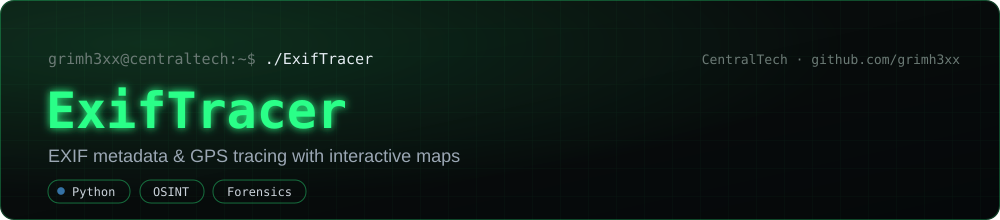
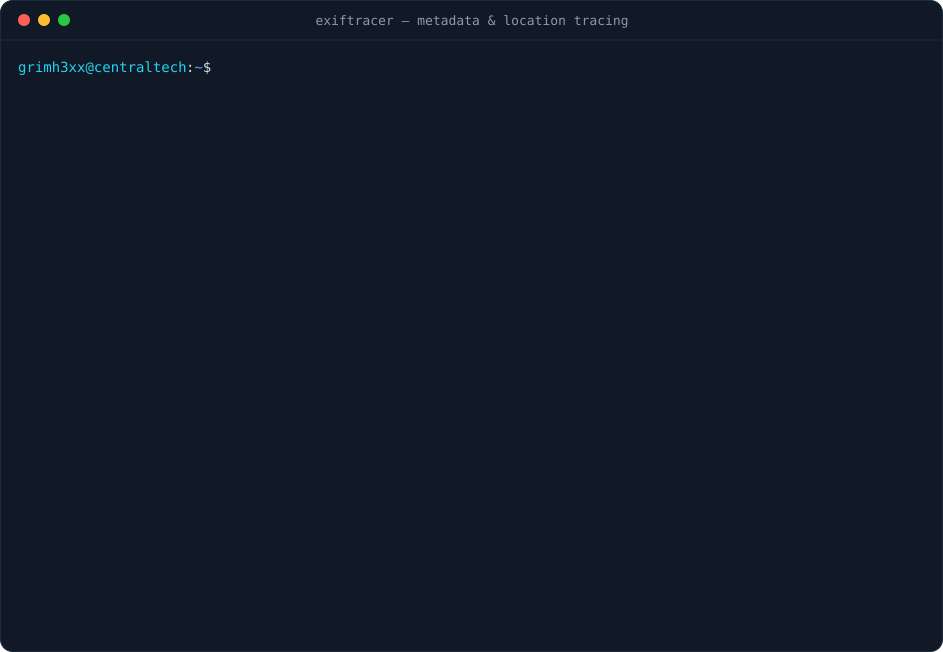

[](https://github.com/grimh3xx/ExifTracer/actions)
[](https://github.com/grimh3xx/ExifTracer/releases/latest)
[](LICENSE)


**Find out what your images give away, put it on a map, and remove it.**
ExifTracer reads the metadata hidden in photos: where they were taken, which device took them
(down to its serial number), who owns it, and when. It rates each image by privacy risk, plots
the geotagged ones on an interactive map in the order they were taken, and strips everything
before you share.

<p align="center"></p>

<p align="center"><sub>Demo images are generated, with coordinates of public landmarks.</sub></p>

## Features

- **Everything that identifies you:**
  - GPS coordinates, altitude and the direction the camera was facing
  - camera, lens and their **serial numbers**
  - owner and author
  - date taken, including the time zone
  - editing software and XMP creator tool
- **Privacy risk per image:**
  - `high`: it reveals where the photo was taken.
  - `medium`: it reveals who took it or which device.
  - `low`: technical tags only.
  - `none`: clean.
- **Addresses** from OpenStreetMap Nominatim, following its usage policy (one request per
  second, a proper User-Agent) and cached on disk, so a rescan doesn't query the service again.
- **Interactive map** in one HTML file:
  - numbered markers in the order the photos were taken
  - a dashed line along that route
  - a thumbnail and the details in each popup
  - map and satellite layers
- **Folders, recursively.** Supports JPEG, TIFF, PNG, WebP and **HEIC** (iPhone).
- **Export** to JSON or CSV for spreadsheets, timelines or other tools.
- **`strip`** removes the metadata so you can share safely:
  - rotation is applied to the pixels first, so photos still display the right way up
  - JPEGs keep their original compression (no quality loss)
  - colour profiles are kept
  - every output is re-read to confirm nothing is left

## Install

```bash
pipx install "exiftracer[heic] @ git+https://github.com/grimh3xx/ExifTracer"
```

Or from a clone: `pip install -r requirements.txt` and run `python -m exiftracer`.

## Usage

```bash
exiftracer photo.jpg                          # quick look (same as: exiftracer scan photo.jpg)
exiftracer scan ~/Pictures -r --map trip.html --open
exiftracer show IMG_2041.jpg                  # everything one image reveals
exiftracer scan ./dump -r --json out.json --csv out.csv --offline
exiftracer strip ./to-post -r -o ./clean      # clean copies in ./clean
exiftracer strip photo.jpg --in-place         # overwrite the original
```

| Command | Options |
|---|---|
| `scan PATH...` | `-r` recursive · `-m FILE.html` map · `--open` · `--json FILE\|-` · `--csv FILE` · `--gps-only` · `--offline` |
| `show IMAGE` | `--offline` |
| `strip PATH...` | `-r` · `-o DIR` (default: `NAME.clean.EXT` next to each file) · `--in-place` |

`--offline` skips address lookups: nothing leaves your machine.

## Why it matters

Most phones and cameras write the exact GPS position into every photo. Many sites strip it
when you upload, but **email attachments, chat apps that send "as file", cloud links, forums
and marketplaces often don't**. One photo can give away a home address, a daily routine
or a device serial number that ties several accounts together.

ExifTracer helps from both sides. As an OSINT and forensics tool, it shows what an image
discloses. Before you publish, it lets you check and clean your own photos.

## Development

```bash
pip install -e ".[heic]" pytest
pytest            # test images are generated on the fly, no binary fixtures
```

<details>
<summary>What changed in 2.0</summary>

It was rewritten as an installable `exiftracer` command. New in 2.0:
- device, owner and time extraction, and the risk score
- recursive folders, PNG/WebP/HEIC, and XMP
- the interactive map with the route and thumbnails
- JSON/CSV export and the geocoding cache
- the `strip` command, tests and CI

`python main.py` still works.
</details>

## Legal

Use it on images you own or are authorised to analyse. Location data is personal data in
most jurisdictions.

## License

[MIT](LICENSE) © grimh3xx
